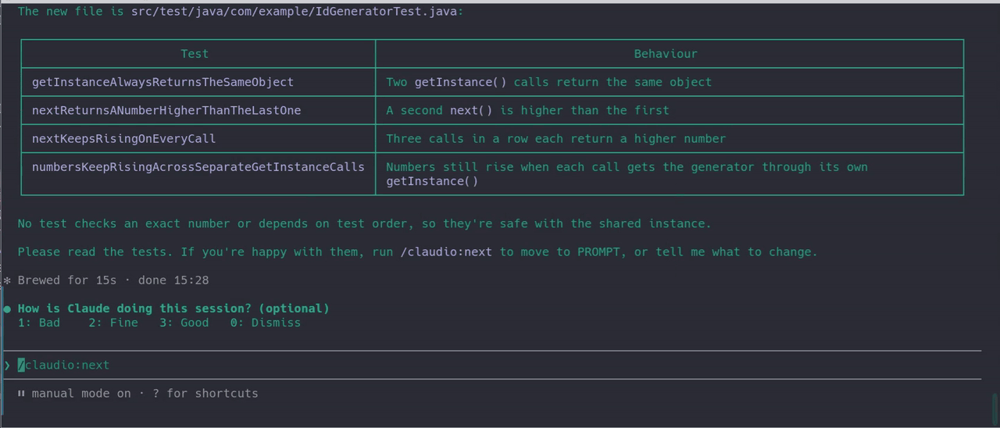

<p align="center">
  
</p>

<h1 align="center">ClaudioXP</h1>

<p align="center">
  Guard rails for AI-assisted development: TDCG cycles, enforced.
</p>

<p align="center">
  <a href="https://github.com/leandrodalbo/claudio-plugin/actions/workflows/ci.yml"></a>
  <a href="LICENSE"></a>
</p>

ClaudioXP is a Claude Code plugin. You work in small TDCG cycles (Test-Driven Code Generation):
Claude writes the code fast, and you decide what is right.

> The AI generates. The human decides what is right and what is not.

ClaudioXP is the project; the plugin and its commands are called `claudio` (`/claudio:next`).

## What we stand for

- **The value is in the problem solved, not in the code written.**
- **Embrace change without losing control.**
- **No "vibing": knowledge and experience are required.**



## What it does

- **Phases with rules:** PLAN → SPECIFY → RED → PROMPT → GREEN → REVIEW → REFACTOR → COMMIT.
  Each phase allows only certain changes, and hooks enforce them.
- **The tests decide:** moving on runs your test command. Claude's word is not enough.
- **You decide:** the plan, the spec, the review and the commit are yours. Only you move the
  phase.
- **Git stays yours:** Claude can read git, never write it.
- **Craft built in:** TDD, XP, Clean Code, Clean Architecture, SOLID and design patterns, given
  to Claude at every step. Tests prove behaviour, not design: you still review.

## Who it's for

Software engineers who want AI's speed and keep responsibility for what they ship. You need the
fundamentals, not to be an expert in the language. [More](docs/README.md#is-it-for-you).

## Install

You need Claude Code, git, and Python 3.11 or newer. Then:

```
claude plugin marketplace add leandrodalbo/claudio-plugin
claude plugin install claudio@claudio-plugin
```

Start a new session, then turn it on in your project:

```
/claudio:init
```

Linux, macOS, and Windows through WSL. Details: [install](docs/install.md).

## Learn more

- [Your first cycle](docs/first-cycle.md)
- [Phases and cycle types](docs/phases.md)
- [Plan and config](docs/plan-and-config.md)
- [Troubleshooting](docs/troubleshooting.md)
- Demos: [TypeScript in VS Code](demos/typescript/TRY-IT-YOURSELF-TYPESCRIPT.md) ·
  [Java in IntelliJ](demos/java/TRY-IT-YOURSELF-JAVA.md)

## Community

- Questions: [Discord](https://discord.gg/pWBncFB4d)
- Bugs and ideas: [issues](https://github.com/leandrodalbo/claudio-plugin/issues/new/choose)
- News: [X @claudioxpplugin](https://x.com/claudioxpplugin)
- Help build it: [contributing](CONTRIBUTING.md) · [code of conduct](CODE_OF_CONDUCT.md) ·
  [security](SECURITY.md)

## License

[Apache 2.0](LICENSE). Copyright 2026 Leandro Dal Bo.
