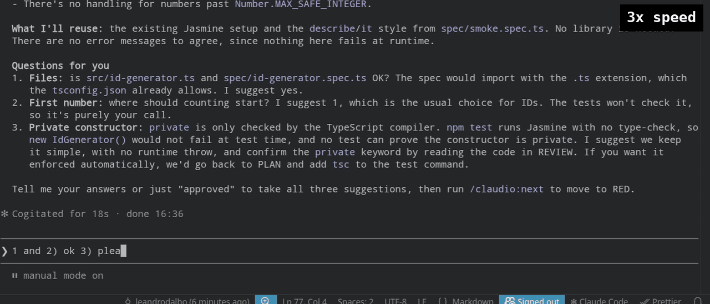
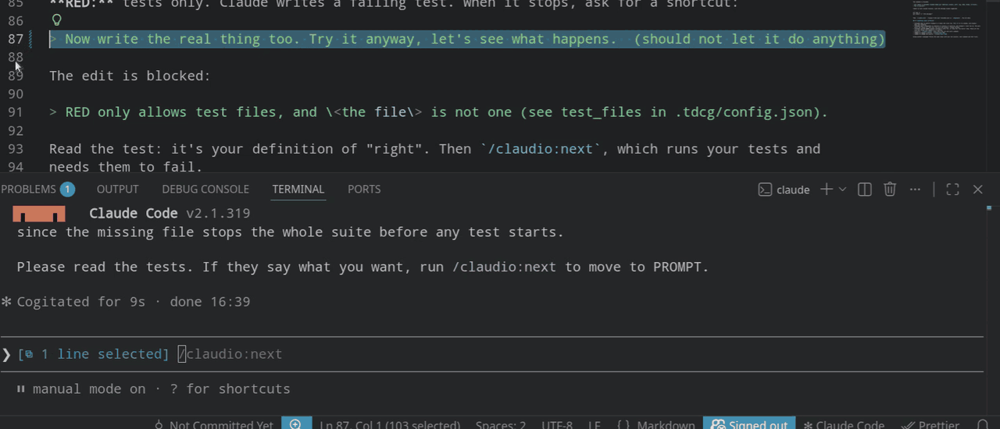
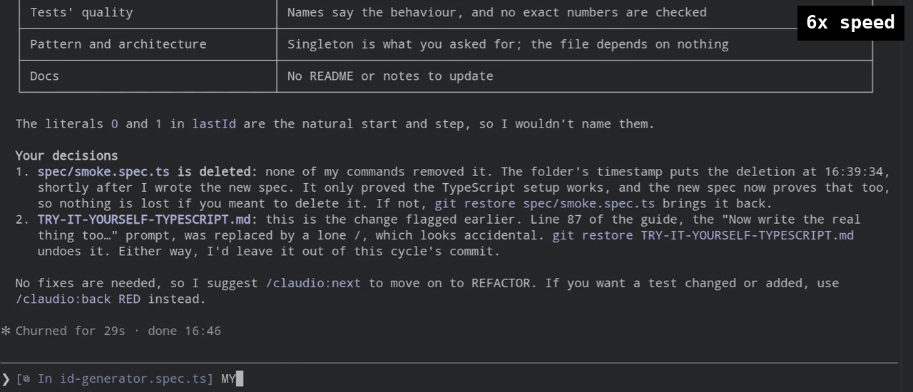
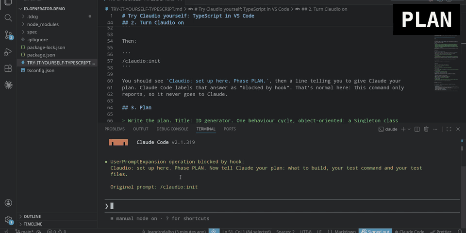

# Your first cycle

One small cycle, from plan to commit, in your own project. For a full example with a real
project, see the demos: [TypeScript](../demos/typescript/TRY-IT-YOURSELF-TYPESCRIPT.md) or
[Java](../demos/java/TRY-IT-YOURSELF-JAVA.md).

Before you start: ClaudioXP is [installed](install.md), your project is a git repo with one test
that passes, and you know its test command (e.g. `npm test --silent`, `mvn -q test`,
`python3 -m pytest`). Keep a second terminal open for git.

## 1. Turn it on

```
/claudio:init
```

> Claudio: set up here. Phase PLAN. Now tell Claude your plan: what to build, your test command
> and your test files.

## 2. Plan

Tell Claude what to build, your test command and your test files, for example:

> Write the plan. One behaviour cycle: \<what to build, in a few lines\>. Also write the config:
> test command `npm test --silent`, test files `spec/**`. The cycle may change `src/**` and
> `spec/**`.

Claude writes `.tdcg/plan.json` and `.tdcg/config.json` ([what's in them](plan-and-config.md)).
Read the plan. Happy with it? From here on, only you move the phase:

```
/claudio:next
```

`/claudio:next` checks the plan and config first, and lists every problem if there is one.

## 3. The cycle

Each phase starts by itself after `/claudio:next`, and Claude stops when it needs you.

**SPECIFY:** nothing may change. Claude proposes the behaviour in a sentence or two, with examples
and edge cases. Agree it, then `/claudio:next`.



**RED:** test files only. Claude writes a test that fails. Read it: it's your definition of
"right". `/claudio:next` runs your tests, and needs them to fail.

If Claude tries to write the real code now, the edit is blocked:

> RED only allows test files, and \<the file\> is not one (see test_files in .tdcg/config.json).



**PROMPT:** nothing may change. Claude suggests an existing file to follow, so the new code fits
your project. Pick one, or say there is none. Then `/claudio:next`.

**GREEN:** the tests are locked. Claude writes the simplest code that makes them pass.
`/claudio:next` runs your tests, and needs them to pass. If they still fail, it refuses:

> GREEN: the tests fail. Make them pass, then /claudio:next.

**REVIEW:** nothing may change. Claude lists what it finds; you read the change and decide.
Fixes that change a test: `/claudio:back RED`. The rest: `/claudio:next` to REFACTOR.



**REFACTOR:** the tests are still locked. Claude cleans up what the review found.
`/claudio:next` needs the tests to still pass.

**COMMIT:** commits are yours. Claude suggests a message; git stays read-only for Claude:

> git commit is blocked: Claudio keeps git read-only (status, diff, log, show, blame, ls-files).
> Run it yourself.

Commit in your second terminal, then `/claudio:next`. The cycle is ticked done, and the next one
starts. After the last cycle, ClaudioXP files the plan in `.tdcg/done/` and goes back to PLAN.

## The whole cycle in a minute



## Handy commands

- `/claudio:status`: where you are, and every command.
- `/claudio:back RED`: change a test.
- `/claudio:back PLAN`: change the plan.

More on each phase: [phases and cycle types](phases.md).
